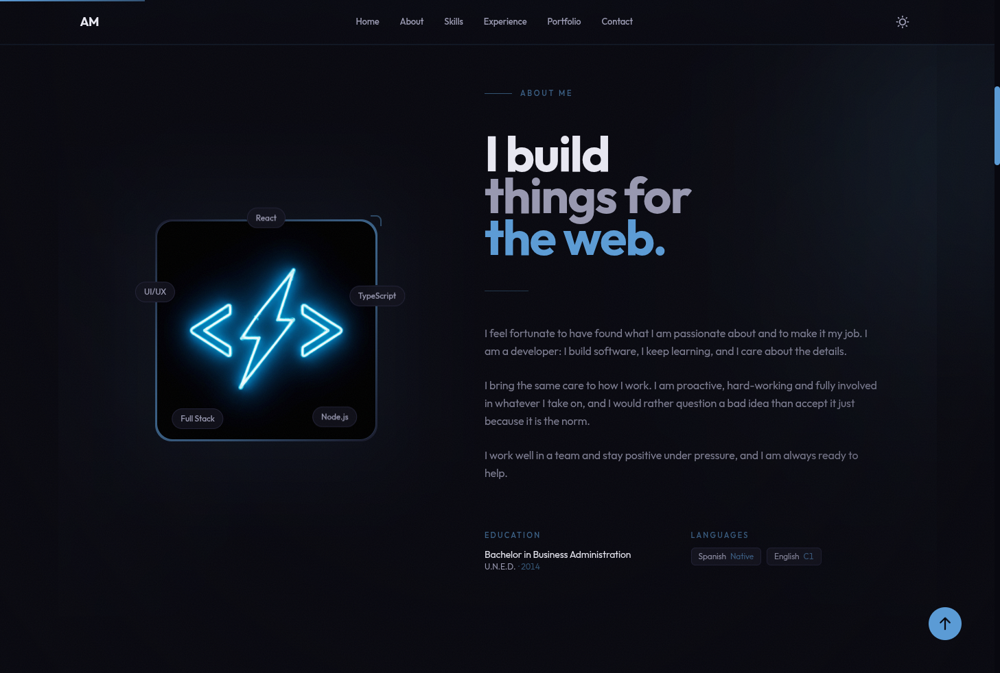

<p align="center">
  
</p>

<h1 align="center">badwatt.com</h1>

<p align="center">
  Personal site: portfolio, experience, skills and a CV that is written in the browser.
  <br />
  <a href="https://badwatt.com">badwatt.com</a> · Astro · React · Tailwind · TypeScript
</p>



> "The most powerful weapon on earth is the human soul on fire." — Ferdinand Foch

## What it is

A single-page site with six sections (home, about, skills, experience, portfolio,
contact) plus a CV generator. All the copy and imagery comes from markdown content
collections, so adding a project or a job is adding a file — not touching a
component.

The CV is the interesting part: pick a palette, clear a captcha, and the PDF is
built in the browser with jsPDF, previewed with pdf.js and downloadable without a
round trip to a server.

## Stack

| Layer     | Choice                                                                 |
| --------- | ---------------------------------------------------------------------- |
| Framework | [Astro](https://astro.build) in `server` output mode (`@astrojs/node`) |
| Islands   | React 19                                                               |
| Styling   | Tailwind CSS v4 through `@tailwindcss/vite`                            |
| Language  | TypeScript, strict                                                     |
| PDF       | jsPDF to build it, pdf.js to preview it (both lazily imported)         |
| Captcha   | [Cap](https://capjs.js.org)                                            |
| Mail      | [EmailJS](https://www.emailjs.com)                                     |
| Fonts     | Outfit and JetBrains Mono, served through Astro's fontsource provider  |
| Toolchain | [Vite+](https://viteplus.dev) for dev, build, test, lint and format    |

## Architecture

`src/` is organised by capability, and each capability keeps the four layers inside
it. Dependencies point inward, one direction only:

```
src/cv/          domain/ application/ infrastructure/ ui/   the CV: model, use case, pdf, viewer
src/content/     domain/ application/                        the site model and how it is loaded
src/captcha/     application/ ui/                            the token rule and the widget
src/contact/     infrastructure/ ui/                         EmailJS behind an adapter
src/theme/       infrastructure/ ui/                          the stored preference and its toggle
src/ui/          components/ hooks/ views/ layouts/          chrome shared by every capability
src/pages/                                                   router and composition root
```

- `domain` imports nothing but its own rules and the shared content model: no framework,
  no DOM, no `import.meta.env`.
- `application` holds one function per use case and declares its ports next to it, so the
  rules are tested with a fake fetcher and a fake clock.
- `infrastructure` holds one adapter per port. `cv/infrastructure/pdf` is split by
  responsibility: `canvas` is the drawing port, `markdown` draws blocks, `sections` and
  `sidebar` draw the page, `generateCv` owns the assets and the page loop.
- A capability never imports another capability's `infrastructure`; the captcha reaches
  the CV and the form through `captcha/application/verifyCaptcha`.
- Composition happens in exactly two places: `src/pages/index.astro` builds the content
  source and `src/cv/ui/useCV.ts` builds the CV client.

Those three rules are executable: `__tests__/architecture/layers.test.ts` reads every
import in `src/` and fails when one of them is broken. `AGENTS.md` has the long version.

## Getting started

### Requirements

- [pnpm](https://pnpm.io) — this repository does not accept npm, yarn or bun
- Node.js (the container installs the latest release with `pnpm runtime set node latest`)

### Install and run

```sh
pnpm install
cp .env.example .env    # fill in the credentials below
vp dev                  # http://localhost:4321
```

> [!NOTE]
> `vp <name>` runs a built-in command, `vp run <name>` runs a `package.json` script.
> They are not interchangeable: `vp dev` starts Vite, `vp run dev` starts Astro.

### Commands

| Command           | What it does                                      |
| ----------------- | ------------------------------------------------- |
| `vp dev`          | Astro dev server on port 4321                     |
| `vp build`        | Production build into `dist/`                     |
| `vp preview`      | Serve the built site                              |
| `vp test`         | Vitest suite                                      |
| `vp run coverage` | Suite with Istanbul coverage, fails below 100%    |
| `vp check`        | Format, lint and type check (also runs on commit) |

## Configuration

`.env.example` lists every variable the site reads:

| Variable                                                       | Read by                    |
| -------------------------------------------------------------- | -------------------------- |
| `PUBLIC_CAP_URL`, `PUBLIC_CAP_SITE_KEY`                        | the captcha widget         |
| `CAP_SECRET`                                                   | `POST /api/cap/verify`     |
| `PUBLIC_SERVICE_ID`, `PUBLIC_TEMPLATE_ID`, `PUBLIC_PUBLIC_KEY` | the contact form (EmailJS) |

`.env.example` also declares `FQDN`, which nothing reads today.

> [!IMPORTANT]
> Without the Cap credentials the CV section cannot get past its captcha, and
> without the EmailJS trio the contact form fails on submit. Everything else —
> all six sections, the CV preview after verification — works with no secrets at
> all.

## Content

`src/content` holds the text the page renders: `portfolio/`, `experience/`,
`about/` and `skills/`. The shape of each file is validated in
`src/content.config.ts` by Astro's content layer.

Adding a portfolio entry is a markdown file with three fields:

```md
---
title: "zix"
image: "../../assets/portfolio/zix/zix.gif"
url: "https://github.com/badwatt/zix"
---

One or two sentences about what it is.
```

The image has to exist next to the other portfolio assets; a test checks that
every entry declares `title`, `image` and `url` and that the file it points at is
really there, so a broken path fails the suite instead of the page.

## How the CV is built

1. Pick a palette — each theme is a set of seven colours in `src/domain/cv/theme.ts`.
2. Clear the Cap captcha. The widget hands over a token, `requestCv` posts it to
   `/api/cap/verify`, and the route asks Cap whether it is genuine.
3. jsPDF lays the document out: a sidebar with the portrait and the contact card, job
   cards split across pages at period boundaries.
4. pdf.js renders the preview. Both libraries are imported on demand, so the initial
   bundle does not carry them.

## Testing

```sh
vp test              # 442 tests
vp run coverage      # 100% statements, branches, functions and lines
```

Coverage is a gate, not a report: `vitest.config.ts` sets all four thresholds to
100%, so a line without a test fails the run. Tests are written first — see the TDD
section of `AGENTS.md`. The only files outside the measure are type declarations,
the content schema and generated Astro output.

## Deployment

Both compose files install, build and run the standalone server on port 4321 with
`node dist/server/entry.mjs`:

- `compose.yml` — Caddy labels
- `compose.traefik.yml` — Traefik router for `badwatt.com` and `azama.es`

`Dockerfile` builds and serves the site with Bun instead (`bun run preview`).
